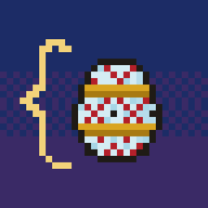
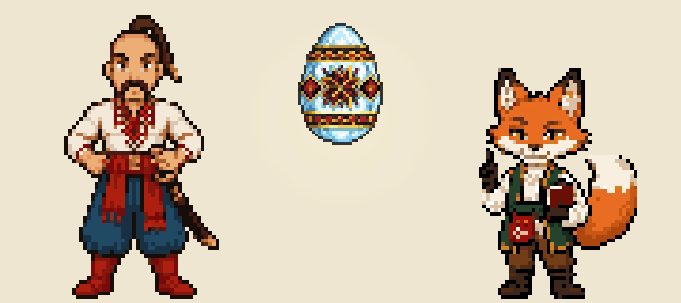
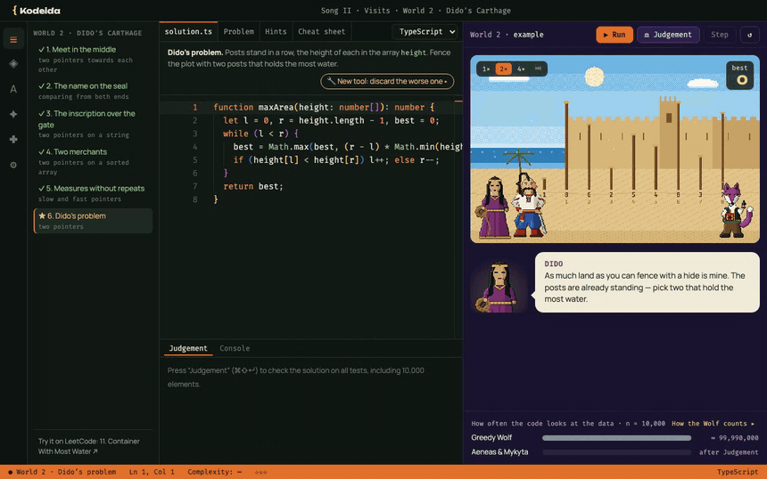
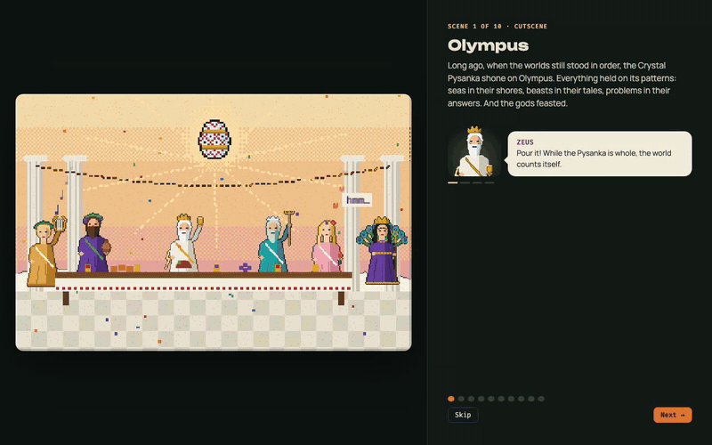
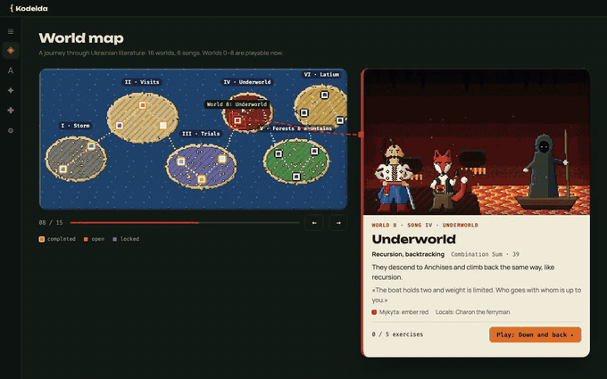
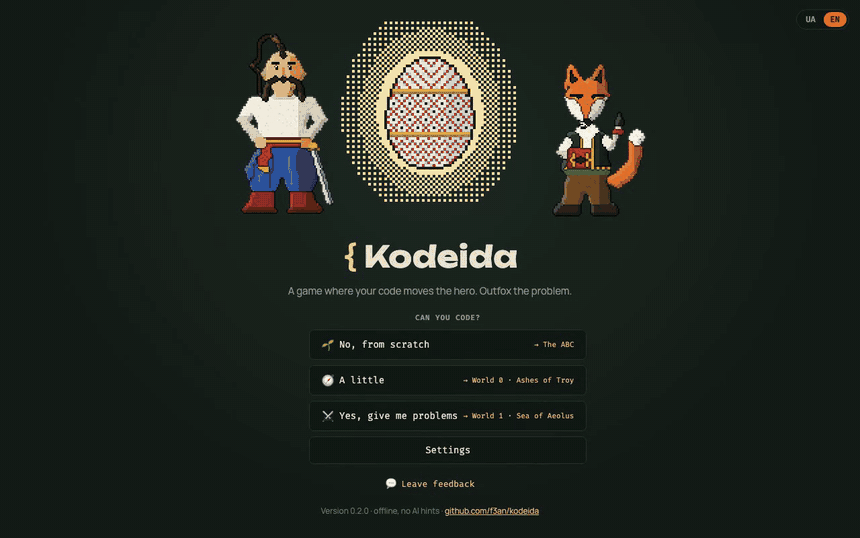

<p align="center">
  
</p>

<h1 align="center">Kodeida · Кодеїда</h1>

<p align="center">
  <b>A game where your code moves the hero.</b><br>
  Learn the techniques behind LeetCode problems with Aeneas and Mykyta the Fox, in worlds from Ukrainian literature.<br>
  Never coded before? Start with the ABC: Python, JavaScript or TypeScript from scratch, on Ukrainian fairy tales.
</p>

<p align="center">
  <a href="https://github.com/f3an/kodeida/releases/latest"></a>
  <a href="https://github.com/f3an/kodeida/actions/workflows/ci.yml"></a>
  <a href="https://github.com/f3an/kodeida/actions/workflows/pages.yml"></a>
  <a href="LICENSE"></a>
  <a href="LICENSE-CONTENT.md"></a>
  
</p>

<p align="center">
  
</p>

<p align="center">
  <a href="https://github.com/f3an/kodeida/releases/latest"><b>Download</b></a> ·
  <a href="https://f3an.github.io/kodeida/#trailer">▶ Trailer</a> ·
  <a href="https://f3an.github.io/kodeida/">Website</a> ·
  <a href="https://f3an.github.io/kodeida/artbook.html">Artbook</a> ·
  <a href="README.uk.md">Українською</a>
</p>

---

You write a function with a real LeetCode signature. The world runs it step by step: Aeneas walks, Mykyta points at the cells your code reads, and the Greedy Wolf shows how many steps brute force would take. No AI hints — the code is yours.

## Contents

- [See it in action](#see-it-in-action)
- [The idea](#the-idea)
- [Three ways in](#three-ways-in)
- [Download](#download)
- [Status](#status)
- [Playtesting](#playtesting)
- [How it works](#how-it-works)
- [Development](#development)
- [Roadmap](#roadmap)
- [Contributing](#contributing)
- [Credits and license](#credits-and-license)

## See it in action

**Solve a real problem and watch every step.** Dido's problem is LeetCode 11, *Container With Most Water*. Run shows the two pointers moving across the posts; Judgement runs the hidden tests, including 10,000 posts, and compares your code with the Wolf's brute force.

<p align="center"></p>

**The story begins on Olympus.** The gods feast around the Crystal Pysanka until Juno and Aeolus break it, and its shards scatter into books of Ukrainian literature. Every character speaks: ten cutscenes lead into the first lines of code.

<p align="center"></p>

**Sixteen worlds, six songs.** Each world is one technique, from arrays and two pointers to graphs and dynamic programming. Nine of them are playable now: worlds 0–8.

<p align="center"></p>

**Never coded? Start with the ABC.** The menu asks whether you can code. *From scratch* opens the ABC: the Sibyl teaches Aeneas on Ukrainian fairy tales the night before Troy falls, in Python, JavaScript or TypeScript, and every printed line appears on a scroll.

<p align="center"></p>

## The idea

Most coding sites hand you problems. Kodeida teaches you to **recognise the technique inside a problem** and understand why it works.

- **Techniques, not answers.** Each world is one technique. Warm-up exercises lead to a real problem: *Container With Most Water*, *Top K Frequent Elements*, *Linked List Cycle*, …
- **See your code run.** A VS Code-style editor on the left, a pixel-art world on the right that replays your code step by step.
- **Wolf vs Mykyta.** After every solution you see how many times brute force would look at the data. O(n²) versus O(n) becomes something you can see.
- **Ukrainian classics.** The frame story is Kotliarevsky's *Eneida*. Aeneas sails from book to book to collect the shards: Franko's fox, *The Mitten*, Lesya Ukrainka's *Forest Song*, Kotsiubynsky's Carpathians, Kvitka-Osnovianenko's *Konotop Witch*.

Languages: TypeScript, JavaScript and Python (via Pyodide, bundled, works offline) today, then C#, C++ and Go. The interface is in Ukrainian and English. The game works offline.

## Three ways in

A new player answers one question in the main menu: **can you code?**

| Answer | Where it leads |
|---|---|
| 🌱 **No, from scratch** | **The ABC** — a separate track for adults who are learning their first language. Pick Python, JavaScript or TypeScript: every lesson is written for that language, and the program's output appears line by line on a scroll. The Sibyl teaches Aeneas on Ukrainian fairy tales the night before Troy falls; when the ABC is done, the story moves on to world 0. |
| 🧭 **A little** | The intro and world 0, *Ashes of Troy*: one new idea per exercise — a command, a loop, a condition, a counter. |
| ⚔️ **Yes, give me problems** | The intro, then straight to world 1, *Sea of Aeolus*. World 0 stays open for review. |

Whichever way you choose, the Sibyl shows you around the interface on your first exercise. **Change level** in the menu reopens the choice without losing progress, and the ABC is always one click away in the sidebar.

## Download

| System | File | Note |
|---|---|---|
| macOS · Apple Silicon | `Kodeida-…-arm64.dmg` | signed and notarized |
| macOS · Intel | `Kodeida-…-x64.dmg` | from 0.1.2 |
| Windows 10/11 | `Kodeida-Setup-….exe` | not signed yet: SmartScreen may ask you to confirm |
| Linux | `Kodeida-….AppImage` | `chmod +x` and run |

All files are on the [latest release](https://github.com/f3an/kodeida/releases/latest); the [website](https://f3an.github.io/kodeida/#download) picks the right one for your system.

The game updates itself. It checks for a new version on start and every 6 hours, downloads it in the background and installs it on restart. You can also check by hand: **Kodeida → Check for Updates…** in the macOS menu (Help on Windows and Linux), or **Settings → Updates**.

## Status

**Pre-alpha, ready for the first playtest.**

- **Playable (v0.5.0):** the onboarding (10 cutscenes, a first run in the real editor, a guided tour by the Sibyl) and worlds 0–8. That is 54 exercises, from the first `enei.move()` to *Combination Sum* in hell, with tests, hints, stars and the Wolf comparison. Cutscenes between worlds. Every problem is written so a 15-year-old can follow it: new terms explained, a worked example, no 10⁴-style constraints.
- **The ABC:** all eight chapters, 4 lessons each in Python, JavaScript and TypeScript: *The Bun* (output), *The Turnip* (variables and numbers), *Kotyhoroshko* (strings), *The Goat Dereza* (conditions), *The Straw Bull* (loops), *Lord Kotsky* (lists), *Sister Fox* (dictionaries and objects), *Ivasyk-Telesyk* (functions). Chapters 2–8 arrived in v0.4.0.
- **New look (v0.5.0):** every hero, world and opening cutscene redrawn as pixel art: 33 living backgrounds with glow, water, smoke and snow, animated cutscenes (the gods' feast, Aeolus's winds, the Pysanka shattering), a backdrop for each ABC tale where the characters step on stage as your program prints, and Aeneas in a zhupan in cold worlds.
- **Designed:** the full story, 16 worlds mapped to techniques, characters and pixel art, the brand. See the [artbook](https://f3an.github.io/kodeida/artbook.html).
- **Shipped:** installers for macOS, Windows and Linux on every release tag, auto-update from GitHub Releases.

The technical plan is in [docs/MVP.md](docs/MVP.md).

## Playtesting

We are looking for 10–20 people, mostly students and juniors who are afraid of algorithms. The question we want to answer: **after world 2, can you solve the real [Container With Most Water](https://leetcode.com/problems/container-with-most-water/) on LeetCode without the game?**

1. Install the [latest release](https://github.com/f3an/kodeida/releases/latest) and play through Dido's problem.
2. Press **Leave feedback** in the main menu, in Settings or in the Help menu, or **Tell us how it went** after Dido's problem. It opens a [short form](https://github.com/f3an/kodeida/issues/new?template=playtest.yml) with your version, system and progress already filled in. You need a GitHub account.

## How it works

- **Your code is ordinary code.** A level is a LeetCode signature such as `maxArea(height: number[]): number`. There is no special game API that does the thinking for you.
- **The world watches what you read.** Arrays and strings are wrapped in a `Proxy` that records every read and write. The recorded events are what the scene animates, and their count is what we compare with the Wolf.
- **A sandbox with a timeout.** Code runs in a Web Worker. An infinite loop ends the run, not the game.
- **Judgement.** Examples, hidden tests and one big test (for example, 10,000 elements) decide the verdict: fox, wolf (correct but too slow), wrong answer, timeout or an error on line N.
- **Pixel art.** Heroes, backgrounds and animations are PNG sprites in [`app/src/assets/art`](app/src/assets/art), drawn ×2 on a low-resolution grid with no smoothing. They were made with the [PixelLab](https://www.pixellab.ai) generator and then edited by hand (faces, heads pasted between frames, cleaned artefacts). Glow, water, smoke and snow on top are drawn in code ([`bgfx.ts`](app/src/world/bgfx.ts)). The first version of the art, drawn entirely from shapes in [`site/app.js`](site/app.js), still renders the map, the UI and anything that has no new sprite yet.

## Development

Requires Node.js 22 or newer.

```bash
cd app
npm install
npm run dev            # in the browser: http://localhost:5173
npm start              # build and open the Electron app
npm run selftest       # engine and every level, without a browser
npm run typecheck
npm run sync-sprites   # copy sprites, scenes and the map from site/app.js
npm run dist           # installers for the current OS into app/release/
```

Environment variables: `KODEIDA_USER_DATA=/tmp/kd` starts with a fresh profile (onboarding from scratch); `KODEIDA_SMOKE=1` runs a smoke test and exits; `KODEIDA_SMOKE=update` checks for updates in a packaged build.

The website has no build step:

```bash
cd site
python3 -m http.server 8000   # http://localhost:8000 and /artbook.html
```

The trailer, the release video and the Reels are built with [Remotion](https://www.remotion.dev) in `video/`. They use the game's own art (`npm run art` copies it into `public/art`), and a script synthesises the music:

```bash
cd video
npm install
npm run sfx                            # sound effects → public/
npm run music                          # the trailer's and the release video's music
npm run art                            # the game's art and the site renders → public/art
npm run record                         # game footage at 2× (needs the game running, see CONTRIBUTING)
npm run dev                            # Remotion Studio: preview and edit
npx remotion render Trailer-uk out/kodeida-trailer-uk.mp4
```

See [CONTRIBUTING.md](CONTRIBUTING.md#trailer-and-videos) for the site encode and the Reels cover.

<details>
<summary><b>What's in this repository</b></summary>

```
app/                  the game: Electron + React + TypeScript + Monaco
  electron/           main process: window, app:// protocol, CSP, menu, auto-update
  build/              icons, DMG background, installer art, entitlements
  scripts/            selftest (engine and every level), sync-sprites (site → game)
  src/engine/         sandbox Worker, runner, judge, no UI
  src/levels/         worlds 0–8 as data, the ABC (abetka.ts), English texts, Book of Tricks
  src/assets/art/     PNG sprites, animations and backgrounds (the new pixel art)
  src/world/          art.ts (loads the art), scenes.ts (levels), cutscenes.ts, bgfx.ts (living backgrounds), sprites.js (generated from site/app.js)
  src/ui/             screens: menu, onboarding, level, map, ABC, book, shirt, settings; story.ts — ABC cutscenes; DevScreen.tsx — dev panel (any level or cutscene, dev builds only)
site/                 the website, deployed to GitHub Pages
  index.html          landing page (UA / EN)
  artbook.html        artbook (UA / EN): animations, screens, UI kit, onboarding, identity, motion
  media/              the trailer (UA / EN), its posters; media/art/new — renders of the new art for the landing and the artbook
  newart.js           puts the new art on the landing and the artbook (app.js stays shared with the game)
  app.js              pixel-art renderer, scenes, journey map, i18n; the game imports it
  style.css           shared styles, light and dark themes
docs/
  NOTES.md            the original idea, decisions and plan
  MVP.md              technical plan of the MVP
  BRAND.md            brand book: name, mascot, palette, voice
  LORE.md             world, characters, the Crystal Pysanka
  STORY.md            the full campaign: 6 songs, 16 worlds, problems per world
  ONBOARDING.md       scene-by-scene script of the intro
  media/              the logo and the GIFs in this README
video/                the trailer, the release video and the Reels (Remotion)
  src/timeline.mjs    the trailer laid out in bars, shared by the picture and the music
  src/scenes/         trailer scenes; src/launch/ — the release video and the Reels
  scripts/            music.mjs (synthesised soundtrack), record.mjs (game footage)
```

</details>

Every push to `main` that touches `site/` redeploys GitHub Pages. To publish a release, bump the version in `app/package.json` and push a `vX.Y.Z` tag. See [CONTRIBUTING.md](CONTRIBUTING.md#releases).

## Roadmap

1. ✅ **Technical plan and the first level:** sandboxed runner, event log, animation, tests, the Wolf comparison.
2. ✅ **MVP:** onboarding and worlds 0–3 (Ashes of Troy, Sea of Aeolus, Dido's Carthage, Mykyta's Forest), TypeScript, JavaScript and Python, Ukrainian and English, installers, releases and auto-update.
3. **First playtest** with 10–20 people. ← *we are here*
4. ✅ **Python** in the app (Pyodide), then **all 16 worlds**, the Book of Tricks and the embroidered-shirt progress.
5. ✅ **The ABC** for complete beginners: the track, the three ways in and all eight chapters.
6. **C#, C++, Go**, then new campaigns: algorithms, data structures, OOP.

## Contributing

Ideas, art, story, translations and accessibility feedback are welcome right now. The app is young and changes fast, so for code please open an issue first so we can agree on the approach. Start with [CONTRIBUTING.md](CONTRIBUTING.md). By taking part you agree to the [Code of Conduct](CODE_OF_CONDUCT.md).

Want to propose a new world? Use the **World idea** issue template: one work of Ukrainian literature in the public domain, one technique.

Security issues: report them privately, see [SECURITY.md](SECURITY.md). Accessibility barriers are bugs, see [ACCESSIBILITY.md](ACCESSIBILITY.md).

## Credits and license

Characters and settings are based on public-domain texts: Ivan Kotliarevsky (*Eneida*), Ivan Franko (*Mykyta the Fox*, *The Painted Fox*), Lesya Ukrainka (*The Forest Song*), Mykhailo Kotsiubynsky (*Shadows of Forgotten Ancestors*), Hryhorii Kvitka-Osnovianenko (*The Konotop Witch*) and Ukrainian folk tales. All designs are original; nothing is copied from film or cartoon adaptations.

- **Code** (`app/`, `site/`, workflows): [Apache License 2.0](LICENSE).
- **Content** (story, lore, brand and design documents in `docs/`, the pixel art in `app/src/assets/art` and `site/media/`, the images in `docs/media/`): [CC BY-SA 4.0](LICENSE-CONTENT.md). The art was made with the help of [PixelLab](https://www.pixellab.ai); see the license file for details.
