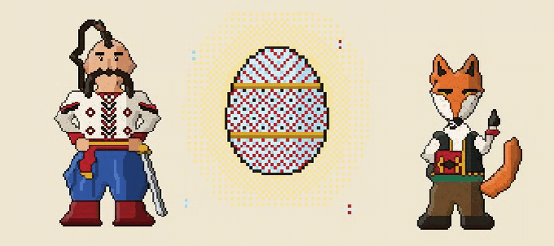
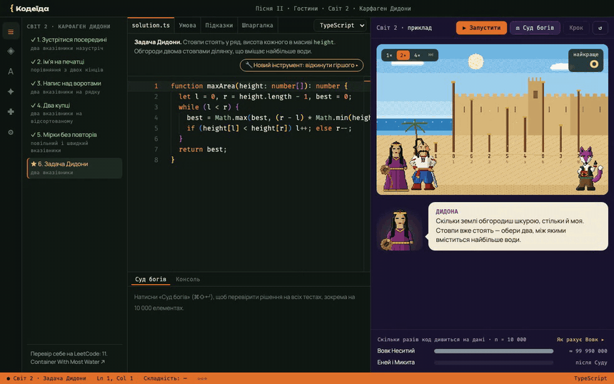
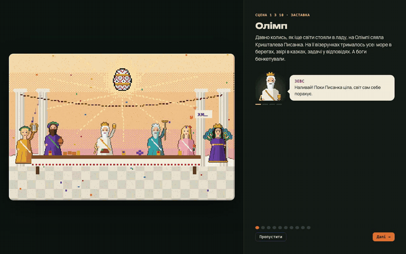
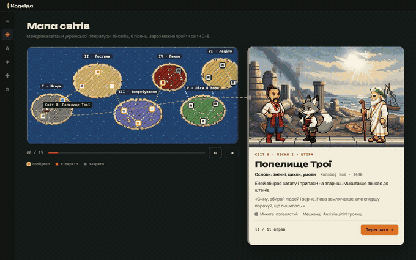

<p align="center">
  
</p>

<h1 align="center">Кодеїда · Kodeida</h1>

<p align="center">
  <b>Гра, де твій код рухає героя.</b><br>
  Вивчай прийоми задач з LeetCode разом з Енеєм і Лисом Микитою у світах української літератури.
</p>

<p align="center">
  <a href="https://github.com/f3an/kodeida/releases/latest"></a>
  <a href="https://github.com/f3an/kodeida/actions/workflows/ci.yml"></a>
  <a href="https://github.com/f3an/kodeida/actions/workflows/pages.yml"></a>
  <a href="LICENSE"></a>
  <a href="LICENSE-CONTENT.md"></a>
  
</p>

<p align="center">
  
</p>

<p align="center">
  <a href="https://github.com/f3an/kodeida/releases/latest"><b>Завантажити</b></a> ·
  <a href="https://f3an.github.io/kodeida/#trailer">▶ Трейлер</a> ·
  <a href="https://f3an.github.io/kodeida/">Сайт</a> ·
  <a href="https://f3an.github.io/kodeida/artbook.html">Артбук</a> ·
  <a href="README.md">English</a>
</p>

---

Ти пишеш функцію зі справжнім підписом задачі з LeetCode. Світ виконує її крок за кроком: Еней іде, Микита показує клітинки, які читає твій код, а Вовк Неситий показує, скільки кроків зробив би перебір. Без AI-підказок: код пишеш ти.

## Зміст

- [Як це виглядає](#як-це-виглядає)
- [Ідея](#ідея)
- [Завантажити](#завантажити)
- [Стан](#стан)
- [Тестування](#тестування)
- [Як це працює](#як-це-працює)
- [Розробка](#розробка)
- [План](#план)
- [Долучитися](#долучитися)
- [Джерела й ліцензія](#джерела-й-ліцензія)

## Як це виглядає

**Розв'язуєш справжню задачу й бачиш кожен крок.** Задача Дидони — це LeetCode 11, *Container With Most Water*. «Запустити» показує, як два вказівники йдуть назустріч уздовж стовпів. «Суд богів» проганяє приховані тести, зокрема на 10 000 стовпів, і порівнює твій код з перебором Вовка.

<p align="center"></p>

**Історія починається на Олімпі.** Боги бенкетують біля Кришталевої Писанки, доки Юнона й Еол її не розбивають, і уламки розлітаються по книжках української літератури. Усі персонажі говорять: десять заставок підводять до перших рядків коду.

<p align="center"></p>

**Шістнадцять світів, шість пісень.** Кожен світ — один прийом, від масивів і двох вказівників до графів і динамічного програмування. У поточному коді можна пройти перші чотири.

<p align="center"></p>

## Ідея

Більшість сайтів дають задачі. Кодеїда вчить **бачити в задачі прийом** і розуміти, чому він працює.

- **Хитрощі, а не відповіді.** Кожен світ — один прийом. Підвідні вправи ведуть до справжньої задачі: *Container With Most Water*, *Top K Frequent Elements*, *Linked List Cycle*, …
- **Видно, як працює код.** Ліворуч редактор у стилі VS Code, праворуч піксельний світ, що відтворює твій код крок за кроком.
- **Вовк проти Микити.** Після кожного рішення видно, скільки разів перебір подивився б на дані. O(n²) проти O(n) стає видимим.
- **Українська класика.** Рамка — «Енеїда» Котляревського. Еней пливе з книжки в книжку, щоб зібрати уламки Писанки: Франків Лис Микита, «Рукавичка», «Лісова пісня» Лесі Українки, Карпати Коцюбинського, «Конотопська відьма» Квітки-Основ'яненка.

Мови коду: зараз TypeScript, JavaScript і Python (через Pyodide, вбудований, працює без інтернету), потім C#, C++ і Go. Інтерфейс українською й англійською. Гра працює без інтернету.

## Завантажити

| Система | Файл | Примітка |
|---|---|---|
| macOS · Apple Silicon | `Kodeida-…-arm64.dmg` | підписано й нотаризовано |
| macOS · Intel | `Kodeida-…-x64.dmg` | з версії 0.1.2 |
| Windows 10/11 | `Kodeida-Setup-….exe` | поки без підпису: SmartScreen може попросити підтвердити |
| Linux | `Kodeida-….AppImage` | `chmod +x` і запустити |

Усі файли — в [останньому релізі](https://github.com/f3an/kodeida/releases/latest); [сайт](https://f3an.github.io/kodeida/#download) сам підбирає потрібний для твоєї системи.

Гра оновлюється сама. Вона перевіряє нову версію під час запуску й кожні 6 годин, завантажує її у фоні й ставить після перезапуску. Перевірити можна й вручну: **Kodeida → Перевірити оновлення…** у меню macOS (на Windows і Linux — у «Довідці») або **Налаштування → Оновлення**.

## Стан

**Пре-альфа, готова до першого тесту.**

- **Можна пройти в поточному коді:** вступ (10 заставок, перший запуск у справжньому редакторі, тур Сивілли) і світи 0–3. Це 29 вправ: від першого `enei.move()` до *Top K Frequent Elements* у лісі Лиса Микити, з тестами, підказками, зірками й порівнянням з Вовком.
- **Придумано:** увесь сюжет, 16 світів із прийомами, персонажі й піксель-арт, бренд. Усе це є в [артбуці](https://f3an.github.io/kodeida/artbook.html).
- **Випущено:** інсталятори для macOS, Windows і Linux з кожного тегу релізу, автооновлення з GitHub Releases.

Технічний план — у [docs/MVP.md](docs/MVP.md).

## Тестування

Шукаємо 10–20 людей, насамперед студентів і джунів, які бояться алгоритмів. Головне питання тесту: **чи розв'яжеш після світу 2 справжню [Container With Most Water](https://leetcode.com/problems/container-with-most-water/) на LeetCode без гри?**

1. Встанови [останній реліз](https://github.com/f3an/kodeida/releases/latest) і пройди до Задачі Дидони включно.
2. Натисни **Залишити відгук** у головному меню, налаштуваннях чи в меню «Довідка» або **Розкажи, як пройшло** після Задачі Дидони. Відкриється [коротка форма](https://github.com/f3an/kodeida/issues/new?template=playtest.yml) з уже заповненими версією, системою й прогресом. Потрібен акаунт GitHub.

## Як це працює

- **Твій код — звичайний код.** Рівень — це підпис з LeetCode, наприклад `maxArea(height: number[]): number`. Ігрового API, яке думало б замість тебе, немає.
- **Світ стежить, що ти читаєш.** Масиви й рядки загорнуті в `Proxy`, який записує кожне читання й запис. Ці події анімує сцена, а їх кількість ми порівнюємо з Вовком.
- **Пісочниця з тайм-аутом.** Код виконується у Web Worker. Нескінченний цикл зупиняє прогін, а не гру.
- **Суд богів.** Приклади, приховані тести й один великий тест (наприклад, на 10 000 елементів) визначають вердикт: по-лисячому, по-вовчому (правильно, але повільно), неправильна відповідь, час вийшов або помилка на рядку N.
- **Піксель-арт з коду.** Файлів із зображеннями немає. Кожного персонажа й сцену намальовано з фігур у [`site/app.js`](site/app.js), збільшено через Scale2x і затінено. Сайт і гра використовують той самий код.

## Розробка

Потрібен Node.js 22 або новіший.

```bash
cd app
npm install
npm run dev            # у браузері: http://localhost:5173
npm start              # зібрати й відкрити застосунок Electron
npm run selftest       # рушій і кожна вправа, без браузера
npm run typecheck
npm run sync-sprites   # скопіювати спрайти, сцени й мапу з site/app.js
npm run dist           # інсталятор для поточної системи в app/release/
```

Змінні середовища: `KODEIDA_USER_DATA=/tmp/kd` — чистий профіль (вступ з нуля); `KODEIDA_SMOKE=1` — смоук-тест і вихід; `KODEIDA_SMOKE=update` — перевірка оновлень у зібраному застосунку.

Сайт збирати не треба:

```bash
cd site
python3 -m http.server 8000   # http://localhost:8000 і /artbook.html
```

<details>
<summary><b>Що в репозиторії</b></summary>

```
app/                  гра: Electron + React + TypeScript + Monaco
  electron/           головний процес: вікно, протокол app://, CSP, меню, автооновлення
  build/              іконки, фон DMG, картинки інсталятора, entitlements
  scripts/            selftest (рушій і кожна вправа), sync-sprites (сайт → гра)
  src/engine/         пісочниця у Worker, запуск, суддя, без інтерфейсу
  src/levels/         світи 0–3 як дані, англійські тексти, Книга хитрощів
  src/world/          sprites.js (генерується з site/app.js) і сцени рівнів
  src/ui/             екрани: меню, вступ, рівень, мапа, книга, сорочка, налаштування
site/                 сайт, деплоїться на GitHub Pages
  index.html          лендінг (UA / EN)
  artbook.html        артбук (UA / EN): анімації, екрани, UI-кіт, вступ, айдентика
  app.js              піксельний рендерер, сцени, мапа мандрівки, переклад; гра імпортує його
  style.css           спільні стилі, світла й темна теми
docs/
  NOTES.md            ідея, рішення й план
  MVP.md              технічний план MVP
  BRAND.md            бренд: назва, маскот, палітра, голос
  LORE.md             світ, персонажі, Кришталева Писанка
  STORY.md            уся кампанія: 6 пісень, 16 світів, задачі для кожного світу
  ONBOARDING.md       сценарій вступу сцена за сценою
  media/              лого й GIF-ки з цього README
```

</details>

Кожен пуш у `main`, що змінює `site/`, оновлює GitHub Pages. Щоб випустити реліз, підніми версію в `app/package.json` і запуш тег `vX.Y.Z`. Деталі — у [CONTRIBUTING.md](CONTRIBUTING.md#releases).

## План

1. ✅ **Технічний план і перший рівень:** пісочниця, лог подій, анімація, тести, порівняння з Вовком.
2. ✅ **MVP:** вступ і світи 0–3 (Попелище Трої, Море Еола, Карфаген Дидони, Ліс Лиса Микити), TypeScript, JavaScript і Python, українська й англійська, інсталятори, релізи й автооновлення.
3. **Перший тест** на 10–20 людях. ← *ми тут*
4. ✅ **Python** у грі (Pyodide), далі **усі 16 світів**, Книга хитрощів і вишиванка-прогрес.
5. **C#, C++, Go**, далі нові кампанії: алгоритми, структури даних, ООП.

## Долучитися

Зараз особливо потрібні ідеї світів, арт, сюжет, переклади й відгуки про доступність. Застосунок молодий і швидко змінюється, тож щодо коду спершу відкрийте issue, щоб домовитися про підхід. Почніть із [CONTRIBUTING.md](CONTRIBUTING.md). Беручи участь, ви погоджуєтеся з [Кодексом поведінки](CODE_OF_CONDUCT.md).

Хочете запропонувати новий світ? Шаблон issue **World idea**: один твір української літератури в суспільному надбанні, один прийом.

Про вразливості повідомляйте приватно, див. [SECURITY.md](SECURITY.md). Бар'єри доступності — це баги, див. [ACCESSIBILITY.md](ACCESSIBILITY.md).

## Джерела й ліцензія

Персонажі й місця створено за текстами в суспільному надбанні: Іван Котляревський («Енеїда»), Іван Франко («Лис Микита», «Фарбований Лис»), Леся Українка («Лісова пісня»), Михайло Коцюбинський («Тіні забутих предків»), Григорій Квітка-Основ'яненко («Конотопська відьма») та українські народні казки. Дизайн власний, нічого не скопійовано з екранізацій чи мультфільмів.

- **Код** (`app/`, `site/`, воркфлоу): [Apache License 2.0](LICENSE).
- **Контент** (сюжет, лор, бренд і дизайн-документи в `docs/`, зображення в `docs/media/`): [CC BY-SA 4.0](LICENSE-CONTENT.md).
